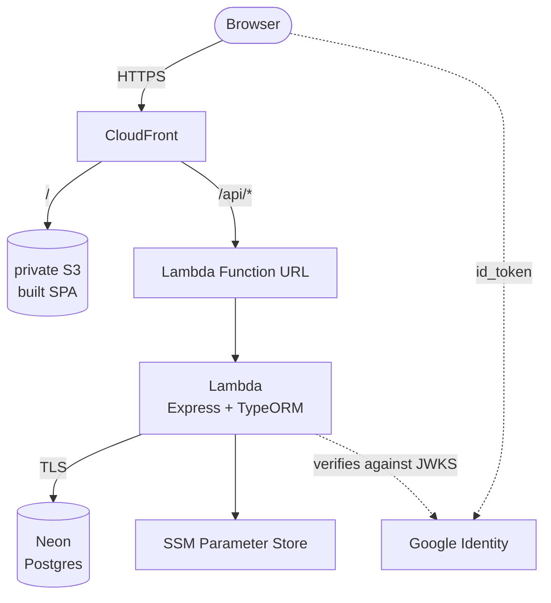

## The product

You sign in with Google, pick the genres you like and get one movie at a time, with a curator's
note and where to stream it. Four buttons: *undo*, *not interested*, *want to watch* and *already
watched*, which asks whether you liked it. Every movie you like adds points to its tags, and that
running profile ranks what comes next. Filters by streaming service and tag, the two lists and
achievements ("Que drama!" after five dramas) sit around the deck.

The product was built in a single semester by a team at
[AGES](https://tools.ages.pucrs.br/cine-clube/cineclube-wiki), PUCRS's software engineering
agency. **Everything below is what I added afterwards**, on my own.

## Moving to serverless

The original deployment was one EC2 instance running nginx, the API and Postgres, billed by the
hour even when idle. Now:

- the built SPA lives in a **private S3 bucket**, served through CloudFront with Origin Access
  Control;
- Express is wrapped by `serverless-http` in a **Lambda**, reached through a Function URL that
  only CloudFront uses;
- Postgres moved to **Neon**, with TLS against a verified certificate;
- SPA and API share one domain, so there is no CORS at all.

The handler builds the app outside the invocation to reuse warm containers, and rechecks the
database connection on every call: Neon's pooler closes idle connections, and a container can
come back warm holding a dead one.

## Authentication

What had replaced Firebase verified nothing: the token was base64 JSON built by the client, so
sending someone's id returned their data. Signing on the frontend wouldn't help, since the key
would ship in the bundle. Now:

1. Google Identity Services hands an `id_token` to the browser;
2. the backend verifies it against Google's JWKS, pinning `audience` and `issuer`;
3. the backend issues its **own** 8-hour session in an `HttpOnly; Secure; SameSite=Lax` cookie.

## Secrets

Secrets live in SSM Parameter Store as `SecureString`, read once at cold start. Lambda
environment variables were ruled out on purpose: `lambda:GetFunctionConfiguration` is part of the
managed `ReadOnlyAccess` policy, so anyone with read-only access to the account could read them.
