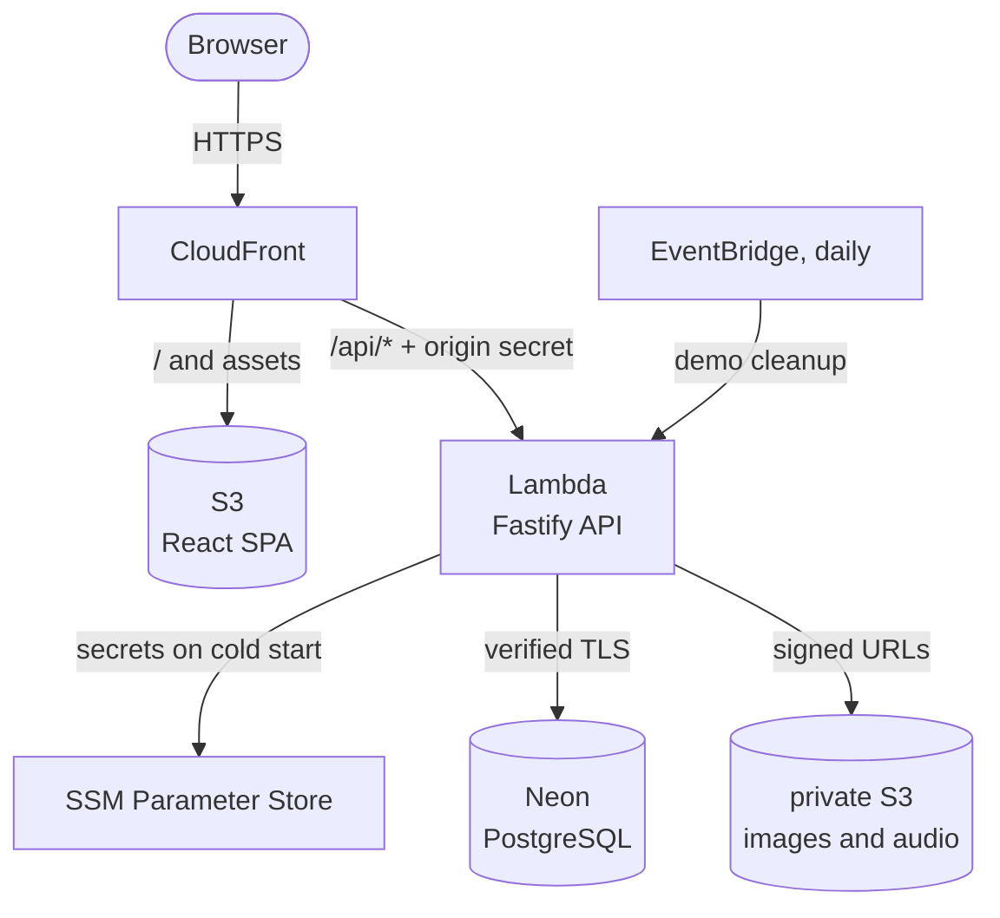

## Why it exists

This started as coursework for *Trends in Software Engineering*: can Spec-Driven Development keep
an AI-assisted codebase honest? Every feature began as a specification written with
[GitHub Spec Kit](https://github.com/github/spec-kit). I acted as Product Owner, Claude Code as
architect, and AI workers wrote the code under a written constitution.

## What it does

- **Decks and cards**: text, image and audio cards, with search and filters.
- **Spaced repetition**: SM-2 with a four-level rating decides when each card comes back.
- **Temporary decks**: mix cards from several decks into one shuffled session.
- **Study schedule**: weekly routines per deck, today's commitments and a week calendar.
- **Statistics and history**: hit rate, a daily chart and the record of every session.
- **Anki export**: one or all decks as an `.apkg` file, with media and review progress.
- **Try it**: "Sign in as Test" creates a disposable account with three demo decks (English,
  flags and Brazilian birdsongs), erased on sign-out.
- **Accounts**: sign up, a sliding session, password change and full account deletion.
- **Interface** in Portuguese, English and Spanish, from 360 px phones to desktop, usable by
  keyboard and screen reader.

## Architecture

- **One API, two runtimes.** The same Fastify app runs locally on SQLite and in the cloud on
  PostgreSQL (Neon), behind a storage port with two real adapters and a shared test battery.
- **CloudFront as the single entry point.** It serves the React SPA from S3 and forwards `/api/*`
  to a Lambda, injecting an origin secret without which the Lambda answers 403.
- **The browser uploads and plays media directly from S3**, a private bucket, through
  short-lived signed URLs; the API only signs them and validates each upload.
- **Scheduled cleanup.** An EventBridge rule invokes the same Lambda to remove abandoned demo
  accounts; a bucket lifecycle rule expires generated exports.
- **Secrets in SSM Parameter Store**, read once on cold start. Infrastructure in OpenTofu;
  GitHub Actions runs the database migrations, then ships the code.
- **Passwords** salted per user, HMAC-SHA256 with a server secret, then scrypt; the session lives
  in an `HttpOnly`, `SameSite=Strict` cookie.
- **Tests** in Vitest and Testing Library, plus Playwright end-to-end in a real browser against
  the real API and database, including layout checks at phone widths and 200% zoom.
